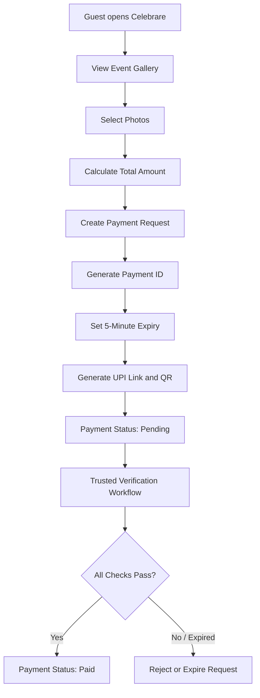

# Celebrare 📸

**A Smart Event Photography Platform**

Celebrare is a web-based event photography platform designed to make it easier for guests to find and access their event photos. It aims to help photographers manage photo access and receive payments directly through UPI.

The platform is being developed with a focus on secure payment handling, photographer-specific payment details, and time-limited payment requests.

---

## 🚀 Project Overview

At events, guests often find it difficult to search for their photographs and purchase them easily.

Celebrare aims to solve this problem by providing:

- An event photo gallery.
- Multiple photo selection.
- Photographer-specific UPI payment details.
- Dynamic payment calculation.
- UPI QR code generation.
- Payment request creation and tracking.
- Five-minute payment request expiry.
- Secure webhook signature validation for a demo payment workflow.

## 🛠️ Tech Stack

### Frontend
- React.js
- JavaScript
- HTML5
- CSS3
- Vite
- qrcode.react

### Backend
- Node.js
- Express.js
- MongoDB
- Mongoose
- REST APIs

### Security
- HMAC-SHA256 signature validation
- Unique transaction ID constraint
- Server-side payment expiry validation
- Photographer and amount matching

---

## 📂 Project Structure

```text
celebrare/
│
├── client/
│   ├── src/
│   │   ├── App.jsx
│   │   ├── App.css
│   │   └── ...
│   ├── package.json
│   └── package-lock.json
│
├── server/
│   ├── models/
│   │   ├── Payment.js
│   │   └── Photographer.js
│   │
│   ├── routes/
│   │   ├── paymentRoutes.js
│   │   └── photographerRoutes.js
│   │
│   ├── server.js
│   ├── package.json
│   └── .env (not committed)
│
└── README.md
```

---

## 🔄 Application Workflow

### 1. Photographer Registration

A photographer registers with:
- Photographer ID
- Name
- UPI ID

The photographer details are stored in MongoDB.

### 2. Photo Selection

Guests open the event gallery and select the photographs they want to access.

The total payment amount is calculated according to the selected photos.

### 3. Payment Request Creation

The backend:
- Identifies the photographer.
- Generates a unique payment request ID.
- Calculates a five-minute expiry time.
- Stores the payment request in MongoDB.
- Generates a UPI payment link using the photographer's UPI details.

### 4. UPI QR Generation

The frontend uses the UPI payment link to generate a QR code.

Each payment request contains the photographer's payment details and the requested amount.

### 5. Payment Status Tracking

The backend maintains three payment statuses:

| Status | Meaning |
|---|---|
| pending | Payment request is waiting for verification |
| paid | Payment has been accepted by the verification workflow |
| expired | Payment request has expired |

### 6. Payment Verification (Demo)

The backend includes a demo webhook verification endpoint.

It checks:
- HMAC-SHA256 signature.
- Payment request ID.
- Photographer ID.
- Payment amount.
- Payment expiry.
- Duplicate transaction ID.

A payment is updated to `paid` only if these checks pass.

**Important:** This is currently a demo webhook workflow. HMAC validation authenticates a sender that knows the shared secret; it does not independently prove that money was received by a bank. Real bank or authenticated payment-provider integration is still required.

---

## 🔁 Workflow Diagram



---

## 🔌 Backend API Endpoints

Base URL:

```text
http://localhost:5000
```

### Photographer APIs

| Method | Endpoint | Description |
|---|---|---|
| POST | `/api/photographers/register` | Register a photographer |
| GET | `/api/photographers/:photographerId` | Get photographer details |

### Payment APIs

| Method | Endpoint | Description |
|---|---|---|
| POST | `/api/payments/create` | Create a payment request |
| GET | `/api/payments/:paymentRequestId` | Check payment status and expiry |
| POST | `/api/payments/webhook/verify` | Verify a signed demo webhook |

### Health APIs

| Method | Endpoint | Description |
|---|---|---|
| GET | `/api/health` | Check backend health |
| GET | `/api/test` | Test backend response |

---

## ⚙️ Installation and Setup

### Prerequisites

Install the following:

- Node.js
- npm
- MongoDB
- Git

### 1. Clone the Repository

```bash
git clone https://github.com/tanutanu25-boop/celebrare.git
```

### 2. Open Project Folder

```bash
cd celebrare
```

### 3. Setup Frontend

```bash
cd client
npm install
npm run dev
```

Open the local URL shown by Vite in your browser.

### 4. Setup Backend

Open another terminal:

```bash
cd ~/celebrare/server
npm install
```

Create a `.env` file inside the server folder:

```env
PORT=5000
MONGO_URI=your_mongodb_connection_string
BANK_WEBHOOK_SECRET=your_private_random_secret
```

Replace the placeholder values with your own configuration. Never upload `.env` to GitHub.

Start the backend:

```bash
node server.js
```

Backend runs on:

```text
http://localhost:5000
```

---

## 🔐 Security Considerations

Celebrare includes several security checks in its demo payment workflow:

- Unique payment request IDs.
- Server-side five-minute expiry validation.
- Photographer ID validation.
- Amount matching.
- HMAC-SHA256 webhook signature validation.
- Duplicate transaction ID protection using a MongoDB unique constraint.
- Atomic payment status updates.

The current webhook is a demonstration, not a production bank integration.

For production use, authenticated bank or payment-provider notifications, transaction reconciliation, secure secret management, and additional monitoring are required.

---

## 📌 Current Development Status

### Implemented

- [x] React frontend setup
- [x] Event photo gallery
- [x] Multiple photo selection
- [x] Dynamic price calculation
- [x] UPI QR code generation (demo)
- [x] Express backend setup
- [x] MongoDB connection
- [x] Photographer registration API
- [x] Photographer details API
- [x] Payment request creation API
- [x] UPI payment link generation
- [x] Five-minute payment expiry validation
- [x] HMAC demo webhook signature validation
- [x] Duplicate transaction ID protection

### Future Improvements

- [ ] Real bank/payment-provider integration
- [ ] Authenticated bank email processing
- [ ] Reliable transaction reconciliation
- [ ] Frontend payment status integration
- [ ] Verified payment-based photo unlocking
- [ ] Photographer dashboard
- [ ] Event management system
- [ ] Automated payment status updates
- [ ] Production deployment

---

## 🎯 Project Goal

The goal of Celebrare is to simplify event photography access and payment management by connecting guests and photographers through a convenient and secure digital platform.

---

## 👩‍💻 Development

**Project:** Celebrare  
**Repository:** https://github.com/tanutanu25-boop/celebrare

Built with React, Node.js, Express, and MongoDB.

*This project is currently under development.*